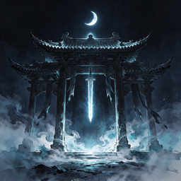
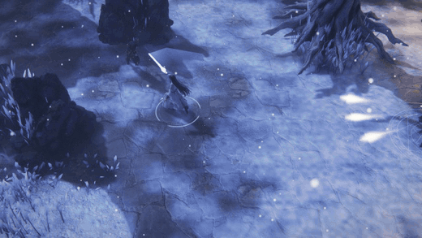
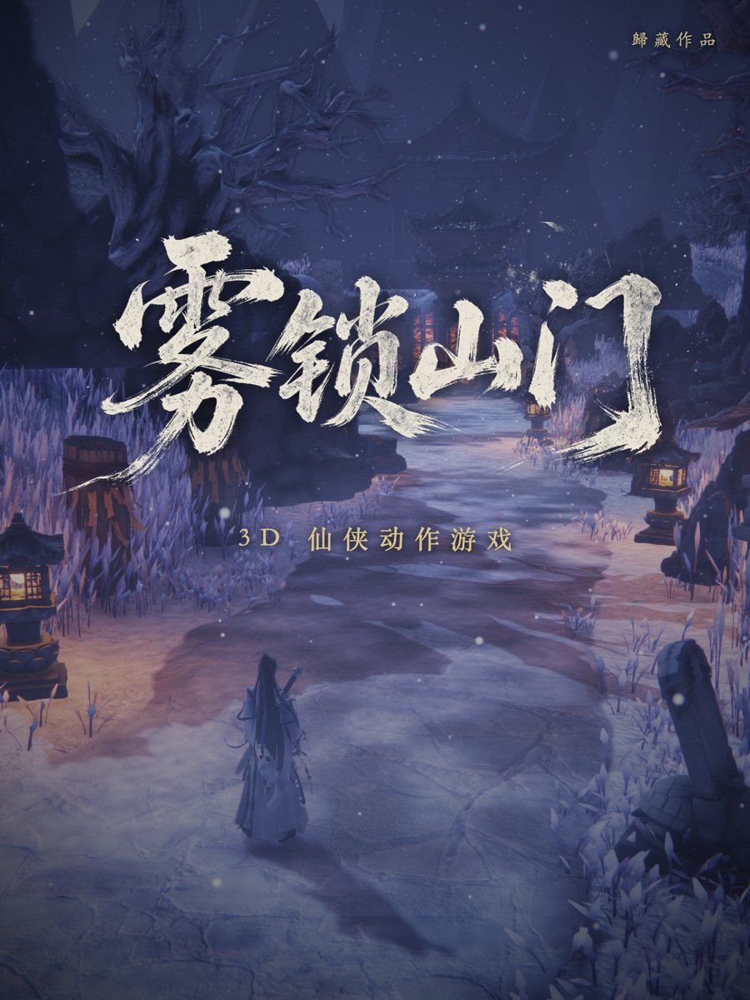
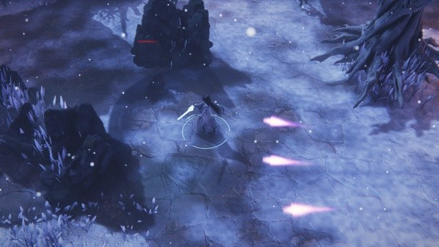
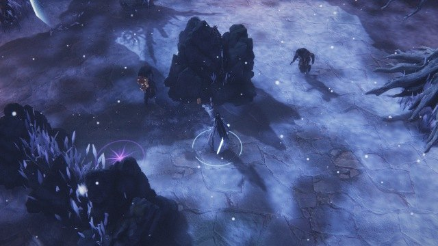
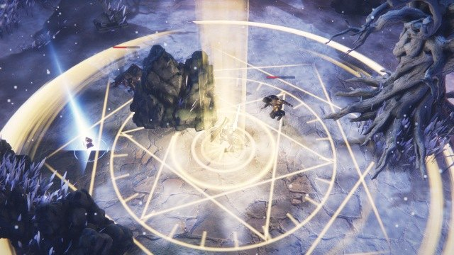

<div align="center">



# Guizang Game Skill

**Have your AI coding agent build a playable 3D action game for the browser, from nothing**

English · [简体中文](README.md)

[](https://op7418.github.io/guizang-game-skill/)
[](LICENSE)
[](https://github.com/op7418/guizang-game-skill/stargazers)

<a href="https://op7418.github.io/guizang-game-skill/"></a>

*Real footage from the demo game, Mist-Locked Gate (雾锁山门). [Play it here](https://op7418.github.io/guizang-game-skill/) on a computer or a phone. Nothing to install. The game's text and voice are in Chinese.*

</div>

---

## What this is

A skill for AI coding agents (Claude Code, Codex and others). Install it, then say "make a top-down wuxia 3D action game", and the agent follows a workflow that has been walked end to end: it asks what you want, connects the asset tools you have, advances and screenshots the game by itself to check its own work, and packs the result into one web page.

The skill is not theory. It is what went wrong, and what survived, while I built Mist-Locked Gate with Fable 5.2 in one afternoon: about 6 hours and 450 million tokens (some of them Opus 5.5 test runs), much of it spent on rework. The skill exists so that you and your agent skip that rework.

## The demo: Mist-Locked Gate

<table>
<tr>
<td width="38%"></td>
<td>

A top-down xianxia action game: one area, one mob encounter, one boss fight, with story and voice acting. **Every creative decision was the AI's.** All I said was "Chinese fantasy".

- **Rendering**: a field of wind-blown grass, layered mist, snow and distant mountains, reflections on a flooded stone platform. The pipeline is hand-built on three.js and uses plain WebGL, so it runs on phones, desktops and inside restricted mini-app containers
- **Characters and props**: 5 rigged 3D characters, 2 weapons, 12 kinds of props, 5 kinds of loot. Concept images first, then image-to-3D with Tripo. The AI wrote every prompt
- **Combat**: a three-hit combo, dodge, guard, parry, riposte, plus healing, sword flight and an ultimate. The boss has a second phase, a rising cutscene and lines
- **Sound**: 8 voiced lines, music, ambience and effects
- **Size**: close to 100 MB of source assets, shipped as one HTML file of about 33 MB that contains every model, texture, track and voice line

</td>
</tr>
</table>

<table>
<tr>
<td></td>
<td></td>
<td></td>
</tr>
<tr>
<td align="center">Three-hit combo</td>
<td align="center">Sword art</td>
<td align="center">Ultimate</td>
</tr>
</table>

Three builds, all from the same source:

| Build | What it is |
|---|---|
| [Hosted](https://op7418.github.io/guizang-game-skill/) | Draws the scene first and loads the rest while it runs. Touch stick and buttons on phones. Settings for quality, high-resolution textures and key bindings |
| Single file | One HTML of about 33 MB that makes no network requests |
| Mini-app container | Built separately for a container with no network, no WASM and a 10 MiB limit (Xiaohongshu mini tools). About 8 MiB |

## What the skill does for you

Ask an agent to "make a 3D game" and you usually get grey boxes, floaty controls and a project you have to set up before it runs. With this skill installed:

1. **It asks before it builds.** References, camera, mood, scope, which asset tools you have and how many credits. It connects those tools from the start instead of writing a box-model placeholder
2. **It checks its own work.** Self-test tooling goes in on day one: frame-by-frame stepping, URL flags that jump straight to a stage, an F3 diagnostics panel. It takes its own screenshots and tells you what it looked at and what merely did not throw
3. **Combat feel is written down.** Wind-up and recovery, hit-stop, tiered knockback, guard and parry, enemies that take turns instead of piling on, a dodge that cancels anything. Where "impact" comes from is spelled out
4. **A list of known pitfalls.** Stuck direction keys, preset animations throwing the character off its spot, blown-out bloom, the camera buried in a roof, characters shrinking to half size after packing. Each with symptom, cause and fix
5. **Three ways to ship.** Large models and assets squeezed small: a single HTML file, a static site that renders before it finishes loading, and an offline package for restricted containers

## Install

Give your agent this repository's link and ask it to install the skill. Or by hand:

```bash
git clone https://github.com/op7418/guizang-game-skill ~/.claude/skills/guizang-game-skill
```

For Codex and other tools, clone into their own skills directory.

Then just say what you want:

```
Make a top-down wuxia 3D action game for the web: one area, one wave of enemies, one boss.
I have Tripo and an image generator available.
```

## What you need

| Thing | Used for | Without it |
|---|---|---|
| Node.js 18+ | Local server and packing | Required |
| [Tripo](https://www.tripo3d.ai/) | Image-to-3D, rigging | Falls back to free models and procedural geometry. It will look worse |
| An image generator (the demo used [Jimeng](https://jimeng.jianying.com/)) | Concept images, icons, title lettering, voice | Falls back to free assets |
| [Suno](https://suno.com/) | Music | The skill writes the prompts for you, or uses generated music |

Asset tools change the result more than anything else. I first let the agent generate models straight from text and they were poor. "Concept image first, then image-to-3D" was a different league.

## Workflow

```
research and plan → setting and assets → animation → feel and effects → sound and packing
```

1. **Research and plan**: read references, look up how this kind of game is made, write a research note and a staged plan
2. **Setting and assets**: world, concept images, image-to-3D, rigging
3. **Animation**: platforms provide few preset clips, so the rest is computed, placing hands and feet pose by pose
4. **Feel and effects**: work through the combat-feel checklist. Effects are meshes and shaders, not piles of particles
5. **Sound and packing**: effects, voice, music, then compress and pack into one file

## Contents

| Path | What is in it |
|---|---|
| [`SKILL.md`](SKILL.md) | The whole workflow and the checkpoints of each stage |
| [`references/assets.md`](references/assets.md) | Generating assets, sources of free ones |
| [`references/characters-animation.md`](references/characters-animation.md) | Characters, rigs and animation |
| [`references/combat-feel.md`](references/combat-feel.md) | Combat feel |
| [`references/vfx-ui-audio.md`](references/vfx-ui-audio.md) | Effects, interface and sound |
| [`references/pitfalls.md`](references/pitfalls.md) | Known pitfalls |
| [`references/packaging.md`](references/packaging.md) | Size reduction, single-file packing, hosting, phones and restricted containers |
| [`scripts/`](scripts) | Reusable input handling, local server and three build scripts |

The skill's documents are written in Chinese. Current agents read them without trouble.

## Set your expectations

- **It is not one prompt to a finished game.** I play-tested Mist-Locked Gate 7 times and reported 5 to 10 problems each round. I do not know game development, so my notes were things like "the movement is stiff" and "hits feel weak". The agent turns those into proper terms, looks them up and fixes them. You still have to play and give feedback
- **Three things I insist on**: give it reference videos, tell it to research before it builds, and stop it from reinventing tools when a real asset tool is available
- **The skill has been through one full project**, plus one plan-level comparison test. It keeps the direction right. It does not guarantee the result

## License

- **The skill** (documents and scripts on the `main` branch): [AGPL-3.0](LICENSE)
- **The demo game's content** (art, models, voice, music, writing, on the `gh-pages` branch): © 2026 Guizang, all rights reserved. Play it and share the link freely. Please do not re-host, rebrand or use it commercially without permission

## Author

[Guizang (歸藏)](https://x.com/op7418). If this helped, a star is appreciated, and I would love to see the game you make with it.
